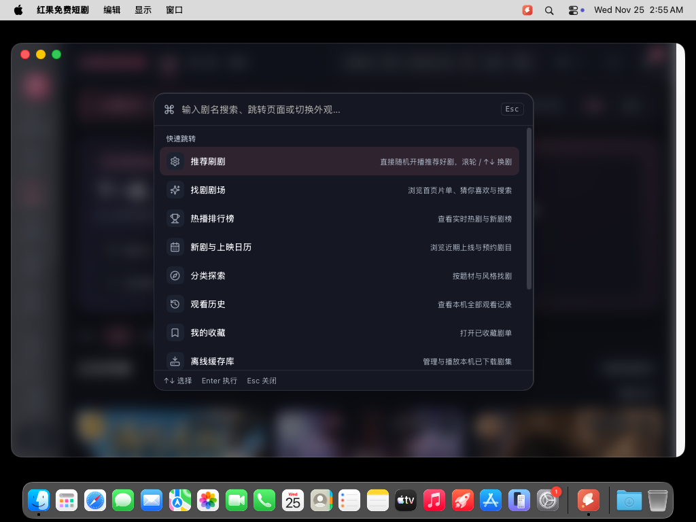
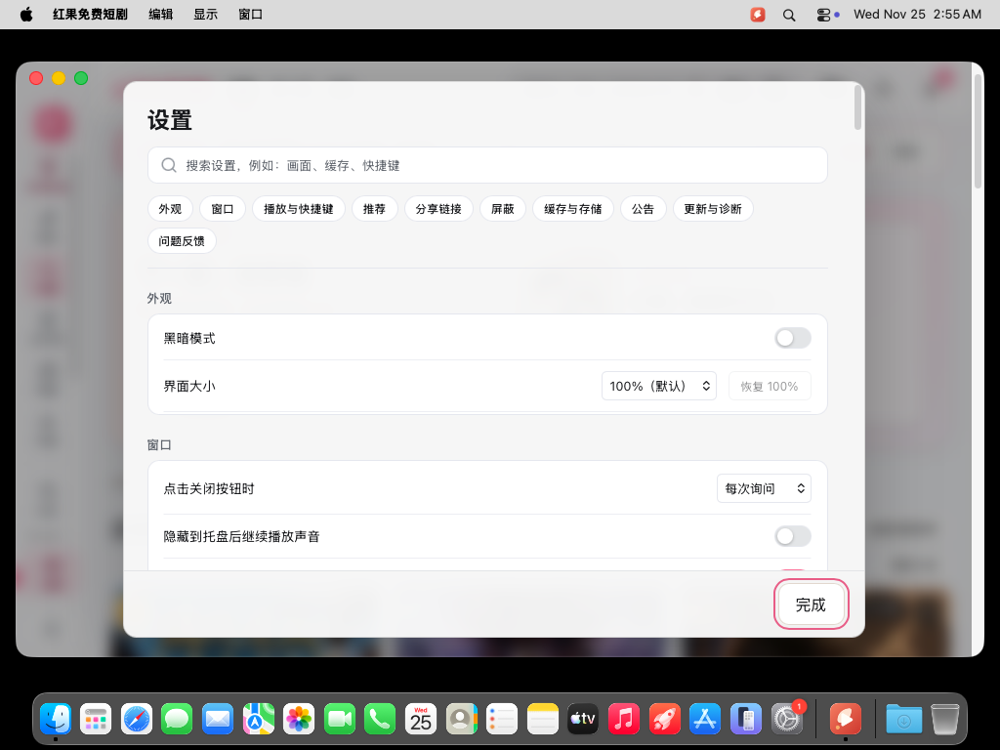

# 红果桌面版 macOS：Apple Silicon + Intel 全系双架构原生体验

由 **渠道有数** 独立维护 · 免费使用 · **Mac 1.0.141 重大更新（macOS 13.0+）**

**[下载 Apple Silicon (M1–M4) DMG · 159.9 MiB](https://github.com/waligoraamodio288-rgb/hongguo-desktop-releases/releases/download/mac-v1.0.141/hongguo-1.0.141-macos-arm64.dmg)**　｜　**[下载 Intel (x86_64) DMG · 159.4 MiB](https://github.com/waligoraamodio288-rgb/hongguo-desktop-releases/releases/download/mac-v1.0.141/hongguo-1.0.141-macos-x64.dmg)**　｜　[发行说明与 SHA-256 校验](https://github.com/waligoraamodio288-rgb/hongguo-desktop-releases/releases/tag/mac-v1.0.141)

**国内免梯子直连通道**：[腾讯文档统一导航卡（微信直开）](https://docs.qq.com/doc/DUkFVbUNJQnhtVkd6) · [百度网盘永久分流（提取码 `3kx4`）](https://pan.baidu.com/s/1rgL9oqPRH7BSLxXDV29feA?pwd=3kx4) · [Gitee 国内镜像页](https://gitee.com/wang-jue12342/hongguo-desktop-releases)

适用于 **macOS 13.0（Ventura）及更新版本**。请先点左上角 ** →「关于本机」**确认本机芯片：显示 **Apple M1 / M2 / M3 / M4** 选 `arm64`，显示 **Intel Core** 选 `x64`。

## 1.0.141 重大更新：按 Apple HIG 重塑，首次覆盖 Intel Mac

本次从 Windows 1.0.141 核心代码完整移植，不再只是简单套壳，而是按 macOS 审美与操作习惯重新打磨：

- **原生 macOS 视觉质感**：融合式 Overlay 标题栏与左上角原生红绿灯、侧边栏真毛玻璃（`NSVisualEffectView` 随浅/深外观自动切换磨砂底色）、SF Pro 与苹方字体排印、移除 Windows 窗控按钮。
- **全套 macOS 交互习惯**：完整原生顶部菜单栏（红果免费短剧 / 编辑 / 显示 / 窗口）、系统托盘菜单、点击红叉隐藏至 Dock 点击即回、AppKit 原生全屏空间（`Esc` 优先退出全屏不误关播放器）、内置 `caffeinate` 播放防息屏，以及访达一键打开离线目录。
- **完整对齐 1.0.141 核心能力**：全站浅/深双主题设计系统、顶部通知中心、官网剧名补查、零转码直连 CENC 播放代理、零白闪切剧、实时推荐升级、离线下载与收藏/历史 SQLite 持久化。
- **攻克 Intel x86_64 兼容**：内置 Unicorn 2.1.4 原生修复补丁，老款 Intel MacBook / iMac 也能直接安装使用。

## 实机界面预览（1.0.141 双架构云端实拍）


*1.0.141 在 Intel macOS 15.7.9 实拍的浅色首页（1280×820），展示融合标题栏、原生红绿灯与展开侧边栏；剧目封面归各自权利方所有。*


*1.0.141 在 Intel macOS 15.7.9 实拍的深色模式，侧边栏原生暗色毛玻璃随系统外观自动同步。*



*1.0.141 在 Apple Silicon macOS 26.7.2 实拍的 `⌘K` Spotlight 风格快捷命令面板。*



*1.0.141 在 Apple Silicon macOS 26.7.2 实拍的 `⌘,` 居中设置弹窗，看剧时调整偏好不中断播放。*

## Mac 快捷键速查

| 快捷键 | 功能说明 |
| --- | --- |
| `⌘K` | 呼出 Spotlight 风格快捷命令面板（找剧 / 切换页面 / 常用动作） |
| `⌘F` | 聚焦搜索；播放页按下自动贴边保播检索下一部 |
| `⌘,` | 前台居中打开设置弹窗，不打断当前播放 |
| `⌘⇧D` | 一键切换浅色 / 深色外观（同步切换原生毛玻璃） |
| `⌘0` | 重置界面缩放比例 |
| `Esc` | 全屏时优先退出 AppKit 原生全屏，不误关播放器 |
| `⌘Q` / `⌘W` | `⌘Q` 完全退出应用；点红叉或 `⌘W` 隐藏至 Dock，点击图标即恢复 |

## 三步安装与首次打开说明

1. 根据本机芯片下载 `hongguo-1.0.141-macos-arm64.dmg`（M 系列）或 `hongguo-1.0.141-macos-x64.dmg`（Intel），并可对照发布页 [SHA256SUMS-mac-v1.0.141.txt](https://github.com/waligoraamodio288-rgb/hongguo-desktop-releases/releases/download/mac-v1.0.141/SHA256SUMS-mac-v1.0.141.txt) 核对完整性。
2. 双击 DMG，将应用拖入 **Applications（应用程序）** 文件夹。
3. **首次打开放行（必读）**：当前版本为 ad-hoc 签名、暂未经过 Apple 官方付费公证。首次打开若提示「无法验证开发者」或「已损坏」，**不要关闭系统完整性保护（SIP）**，请任选以下一种标准方式放行：
   - **图形界面**：打开「系统设置 → 隐私与安全性」，在底部安全提示处点击「仍要打开」；
   - **终端一条命令**：拖入应用程序后，在「终端」执行：
     ```bash
     xattr -cr "/Applications/红果桌面版.app"
     ```
     （若应用包名称为 `红果免费短剧.app`，请按应用程序目录中的实际名称替换。）

### SHA-256 校验值

- `hongguo-1.0.141-macos-arm64.dmg`（`167,625,936` 字节 / 159.9 MiB）：
  `c1d5e542a67aec0066edc5de31d6935c21d670f8d1fda3ca5c2ed07b43f9a61e`
- `hongguo-1.0.141-macos-x64.dmg`（`167,155,103` 字节 / 159.4 MiB）：
  `4a5859517f4db3bc6900ab8df0079373451794daf0eaa4cfa044584fb4ee3fc9`

## 验证边界与反馈入口

- **已完成验证**：已在云端 Apple Silicon（macOS 26.7.2）与 Intel x86_64（macOS 15.7.9）双架构真机完成打包，分别通过 69 项前端单测、415 项 Rust 单元测试、内置后端冷启动握手、封面实时解码与浅/深色窗口实拍验证（Intel 额外通过 Unicorn 2.1.4 原生仿真自检）。
- **待真机用户补充验证**：物理扬声器真实出声、长时间连续播放、短信登录恢复与旧版覆盖升级。Mac 版暂未接入应用内自动更新，需手动下载新版 DMG 覆盖安装；本机观看记录与 Windows / TV 端独立保存。
- **问题反馈**：请填写 [Mac 专属反馈表](https://github.com/waligoraamodio288-rgb/hongguo-desktop-releases/issues/new?template=macos.yml)（注明芯片型号、macOS 版本与复现步骤，勿提交账号凭据），或关注 [Mac 社区追踪帖 #359](https://github.com/waligoraamodio288-rgb/hongguo-desktop-releases/issues/359)。

分享时请保留 **渠道有数** 署名与 [原发行页链接](https://github.com/waligoraamodio288-rgb/hongguo-desktop-releases/releases/tag/mac-v1.0.141)。需要 Windows 或电视版请返回 [项目首页](README.md)。
