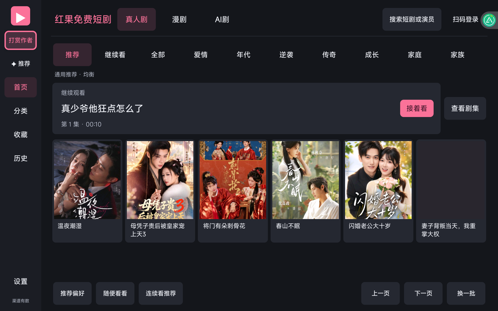
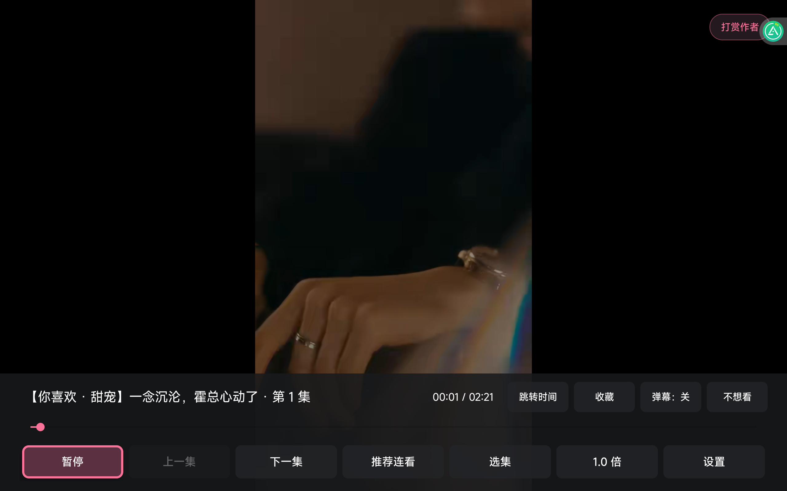

# 红果电视端：用遥控器看短剧，不喜欢就换一部

由 **渠道有数** 独立维护 · 免费使用 · **0.5.18 重大更新**

**[渠道有数网站](https://shiyuemenghui.top/?utm_source=github&utm_medium=readme&utm_campaign=custom_domain)** · [安装帮助](https://shiyuemenghui.top/help/install/?utm_source=github&utm_medium=readme&utm_campaign=custom_domain)

网站暂有部分网络无法访问；遇到打不开时，可直接使用下方 GitHub 安装包和本页说明。

**国内免梯子直连通道**：[腾讯文档统一导航卡（微信直开）](https://docs.qq.com/doc/DUkFVbUNJQnhtVkd6) · [百度网盘永久分流（提取码 `3kx4`）](https://pan.baidu.com/s/1rgL9oqPRH7BSLxXDV29feA?pwd=3kx4) · [Gitee 国内镜像页](https://gitee.com/wang-jue12342/hongguo-desktop-releases)

**[下载32位 ARMv7 · 2.78 MB](https://github.com/waligoraamodio288-rgb/hongguo-desktop-releases/releases/download/tv-v0.5.18/HongguoTV-0.5.18-arm32.apk)**　｜　**[下载64位 ARM64 · 10.13 MB](https://github.com/waligoraamodio288-rgb/hongguo-desktop-releases/releases/download/tv-v0.5.18/HongguoTV-0.5.18-arm64.apk)**　｜　[发行说明与校验](https://github.com/waligoraamodio288-rgb/hongguo-desktop-releases/releases/tag/tv-v0.5.18)

适用于 Android 5.0+ 的电视、盒子、投影和平板。32 位系统选择 ARMv7（`arm32`），64 位系统选择 ARM64（`arm64`）；以系统支持的 ABI 为准，不按芯片宣传位数判断。

## 0.5.18 重大更新：播放恢复、扫码同步、沉浸推荐、极简弹幕与自动更新

- **主片源播放恢复**：同步最新 V5 播放取流与解密协议，修复主片源不可播问题。
- **桌面同款「✦ 推荐」与个性化偏好**：左侧导航新增沉浸式「✦ 推荐」连续刷剧入口；首页推荐支持「均衡 / 热播 / 上新」排序、喜欢/不想看题材、类型偏好、长按不想看与 3+1 防信息茧房策略。
- **红果官方扫码登录与账号同步**：顶部新增「扫码登录」，支持手机红果 App 扫码登录并同步云端收藏与观看历史（保守合并本机记录、写前校验保护进度）；已登录时推荐流会结合账号常看题材精准推送。
- **极简电视弹幕**：原生单画布低开销弹幕渲染，播放控制栏一键切换「弹幕：开 / 关」，设置内提供显示、字号与密度三项简洁调节。
- **应用内自动更新**：支持空闲后台自动下载新版并校验原版签名与 SHA-256（24 小时防循环保护、播放中不打断、返回首页弹窗「立即安装」）；修复历史发行超过 100 条时的多页版本检索；通用设置新增「应用更新」实时状态行。
- **自愿打赏作者入口**：与桌面版位置一致，在首页左侧栏顶部、播放页右上角及「设置 → 关于与帮助」提供自愿支持二维码入口（完全免费，自愿支持）。

*0.5.18 小米 Android 13 平板首页实拍（非老电视实机验收）；剧目封面归各自权利方所有。*

*0.5.18 小米 Android 13 平板播放界面实拍，展示弹幕开关、不想看、推荐连看与右上角自愿支持入口。*

## 低性能电视适配说明

继续保持单播放器、单媒体工作线程、两槽缓冲、单文件 32 MiB 上限与 64 KiB 分块下载；低内存模式海报缓存 2 MiB、自动最高 480p，内存紧张时取消预取并释放封面，不后台常驻转码服务。若某集仅提供高清晰度轨道，手动限制或低内存 480p 可能无法播放；性能充足且支持硬解的设备可在设置选择自动或 1080p。

真人剧、漫剧搜索首次启用仍会说明设备登记并请求同意，取消仍可浏览首页与推荐；搜索结果单次最多 20 条，AI 搜索筛选公开热门片单。倍速播放需 Android 6.0+。实体旧电视、旧固件和主观音画仍待逐机验证。

## 应用内检查与自动更新

- **0.5.2～0.5.12 的 64 位版**与 **0.5.6～0.5.12 的 32 位版**可在「设置 → 关于与帮助 → 检查更新」直接检测并下载 **0.5.18**（若旧版仅拉取第 1 页发行记录，推荐直接从本页链接下载或用新版本空闲自动更新）。**0.5.1 及以前版本**需手动覆盖安装一次。
- **0.5.18 起**默认开启闲时后台自动下载，并在返回首页后弹窗提示安装；播放过程中不打断，下载后核验原版签名与 SHA-256 再交系统安装器确认。

## 三步安装

1. 下载与系统架构匹配的 `HongguoTV-0.5.18-arm32.apk`（2.78 MB）或 `HongguoTV-0.5.18-arm64.apk`（10.13 MB）。32 位系统选 `armeabi-v7a`，64 位系统选 `arm64-v8a`；不确定时查看系统信息或反馈完整型号。
2. 用 U 盘或设备文件传输把 APK 放到电视/盒子上，在文件管理器中打开安装。按设备正常提示授权本次安装。
3. 已有同签名旧版可直接覆盖升级，保留本机收藏、历史、推荐偏好与已登录状态。

[更详细的安装与帮助](https://shiyuemenghui.top/help/install/#android-tv)

## 安装前常见问题

| 问题 | 当前情况 |
| --- | --- |
| 电脑必须开着吗？ | 不需要，电视版可以独立运行。 |
| 能同步手机红果账号的收藏和进度吗？ | 可以。0.5.15+ 支持右上角「扫码登录」，同步红果官方账号云端收藏与观看历史，并结合账号常看题材推荐；未登录时仍只保存在本机。 |
| 支持所有旧电视吗？ | 不保证。最低 Android 5.0，提供 ARMv7 32 位及 ARM64 两种包；旧固件仍需实测，非 Android 系统及仅 armeabi/ARMv5 不适用。 |
| 显示无法安装怎么办？ | 记录设备型号、Android 版本和完整提示，先核对系统架构。不要反复卸载已有可用版本。 |
| 能安装但无法播放怎么办？ | 记录加载、黑屏或报错现象，以及换一部剧是否相同。上游目录、片源和网络都可能影响播放。 |
| 是官方客户端吗？ | 不是。本项目与红果官方无隶属关系。 |

## 欢迎反馈真实设备体验

目前已在小米 M2105K81AC / Android 13 平板 ARM64 与 ARM32 进程完成全部 11 项功能验收。实体电视、盒子与投影的实际使用情况需要逐台记录。

无论能否正常使用，都可以填[电视版反馈表](https://github.com/waligoraamodio288-rgb/hongguo-desktop-releases/issues/new?template=android-tv.yml)：设备型号、Android 版本、能否安装、实体遥控、首播音画、弹幕及扫码同步情况。无需提交账号密码或个人隐私。

分享时请保留 **渠道有数** 署名与[原发行链接](https://github.com/waligoraamodio288-rgb/hongguo-desktop-releases/releases/tag/tv-v0.5.18)。应用「设置 → 关于与帮助」可以核对来源。想在电脑上看，可下载 [Windows 版](https://github.com/waligoraamodio288-rgb/hongguo-desktop-releases/releases/latest)。
