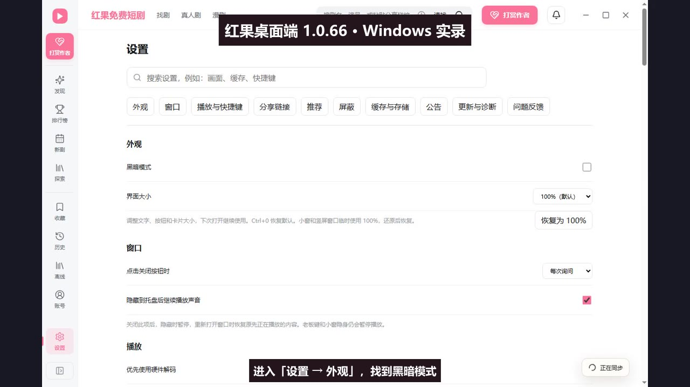
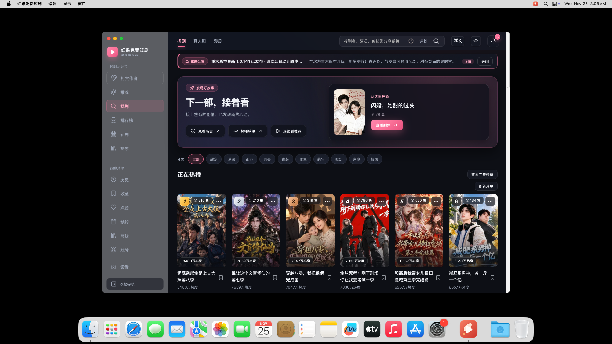
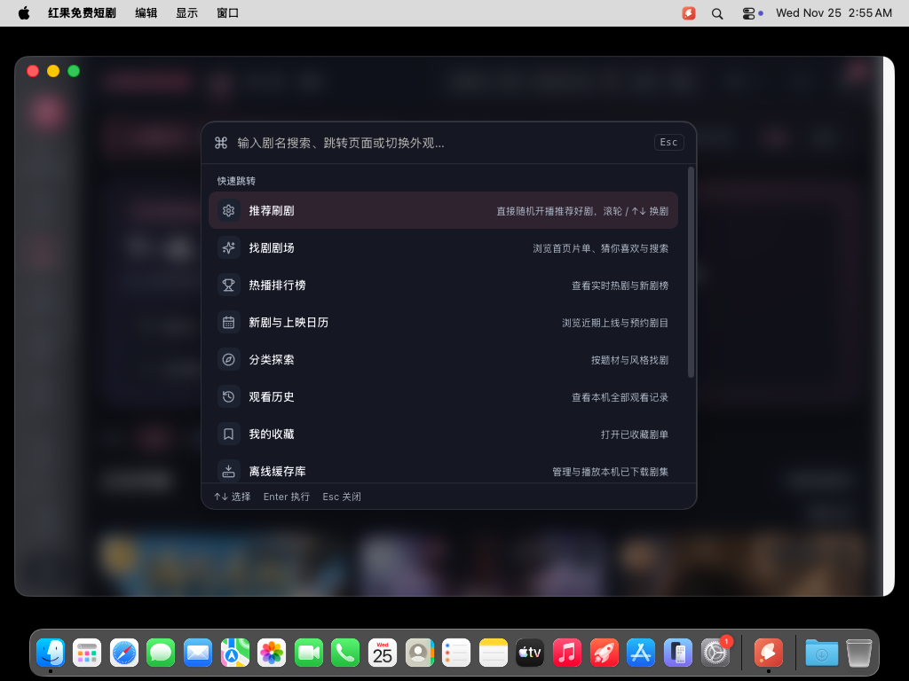

# 红果桌面端：可转载介绍与素材说明

更新：2026-11-26 · 维护者：渠道有数 · 第三方独立客户端

## Windows 1.0.141 重大更新 · 零转码直连、零白闪切剧与智能推荐

> 红果免费短剧 Windows 桌面版迎来 **1.0.141 重大更新**：新增本地内存零转码 CENC 播放代理与双视频帧级预解码，实现**零白闪顺滑切剧与切集**；升级实时推荐算法、极简浅/深双主题设计系统、**Ctrl+K** 快捷命令面板、顶部通知中心与全新应用内自动更新体验。[Windows 固定最新版](https://github.com/waligoraamodio288-rgb/hongguo-desktop-releases/releases/latest) · [1.0.141 重大更新说明](https://github.com/waligoraamodio288-rgb/hongguo-desktop-releases/releases/tag/v1.0.141)

## Mac 1.0.143 更新 · Apple Silicon + Intel 全系双架构原生重塑

> 红果免费短剧 macOS 桌面版迎来 **1.0.141 重大更新**：同步 Windows 1.0.141 核心功能（全站新设计系统、零转码直连与瞬切推荐），按 Apple 人机界面规范重做融合标题栏、原生深/浅毛玻璃侧栏、顶部菜单栏与全套 `⌘` 快捷键（`⌘K` 命令面板、`⌘F` 保播检索、`⌘,` 居中设置弹窗、`⌘⇧D` 深浅外观切换），并**首次完整兼容 Apple Silicon（M1–M4）与 Intel（x86_64）双架构**（macOS 13.0+）。[Mac 双架构安装指南](../MAC.md) · [mac-v1.0.143 发布页与校验](https://github.com/waligoraamodio288-rgb/hongguo-desktop-releases/releases/tag/mac-v1.0.143)
## Windows 摸鱼播放 · 小窗常驻，小电视随鼠标开合

> 红果桌面端的两种摸鱼小窗可以切换使用。想连续看，用置顶的「迷你窗口」。想看一会儿，用「悬浮小电视」，鼠标移入展开续播，移出马上暂停并缩回图标。从普通小窗进入悬浮模式后，点返回即可切回。展开时支持四档窗口大小。
>
> 适用于 Windows 10 / 11 x64，由渠道有数独立维护。[Windows 固定最新版](https://github.com/waligoraamodio288-rgb/hongguo-desktop-releases/releases/latest) · [两种窗口怎么用](WINDOWS-INSTALL.md#普通小窗和悬浮小电视怎么搭配)

## 一句话介绍

在 Windows 电脑上找短剧、选集和接着上次看：红果桌面端支持搜索、收藏、本机观看进度、倍速、小窗与自动连播，免费使用，无需安卓模拟器。

## 适合直接使用的介绍

红果桌面端由渠道有数独立维护，适用于 Windows 10/11 x64。它把找剧、收藏、选集与续看放在同一个电脑窗口中。老板键默认 Ctrl+Shift+B，隐藏时暂停、恢复后保留原位置与倍速；原本手动暂停的内容保持暂停。

当前 Windows 正式版为 1.0.141，Mac 双架构版为 1.0.141，Android TV 测试版为 0.5.12。分享时请使用[固定最新版](https://github.com/waligoraamodio288-rgb/hongguo-desktop-releases/releases/latest)。

项目另有 Mac（Apple Silicon + Intel 双架构，macOS 13.0+）与 Android TV 测试版，系统要求和功能范围各自独立。它不是红果短剧官方出品；应用完整源码未公开。下载不需要关注、回帖或私信取包。

## 下载与参考链接

- [国内免梯子统一导航卡（腾讯文档，微信直开）](https://docs.qq.com/doc/DUkFVbUNJQnhtVkd6)：汇总全端下载、安装教程与 SHA-256 校验。
- [百度网盘永久分流（提取码 `3kx4`）](https://pan.baidu.com/s/1rgL9oqPRH7BSLxXDV29feA?pwd=3kx4)：国内免梯子直下全端安装包。
- [Gitee 国内公开镜像仓库](https://gitee.com/wang-jue12342/hongguo-desktop-releases)：国内高速访问项目首页与更新日志。

- [Windows 固定最新版](https://github.com/waligoraamodio288-rgb/hongguo-desktop-releases/releases/latest)：文章优先保留这个地址，减少版本过期。
- [Windows 1.0.141 发行说明](https://github.com/waligoraamodio288-rgb/hongguo-desktop-releases/releases/tag/v1.0.141)。
- [Windows 安装与排错速查](WINDOWS-INSTALL.md)。
- [Android TV 系统要求与下载](https://github.com/waligoraamodio288-rgb/hongguo-desktop-releases/blob/main/TV.md)。
- [Mac 双架构安装说明与快捷键速查](../MAC.md)（[mac-v1.0.143 发布页](https://github.com/waligoraamodio288-rgb/hongguo-desktop-releases/releases/tag/mac-v1.0.143)）。
- [AI 辅助开发实践](AI-ASSISTED-CASE-STUDY.md)。

## 给第一次安装的读者

1. 打开上方 Windows 固定最新版，展开 **Assets**，选择文件名以 `-setup.exe` 结尾的安装包。
2. 已安装的用户可以先到软件的“设置 → 关于”检查更新。手动覆盖安装时，请先从托盘退出旧程序，沿用原安装目录。
3. 打开软件后搜索剧名，进入详情选集。遇到安装或播放问题，可对照[安装步骤与常见问题](WINDOWS-INSTALL.md)。

## 可用于简介或软件目录的短文案

> **电脑上想边做事边追剧？试试红果桌面端的两种小窗。** 普通小窗置顶持续播，悬浮小电视鼠标移入就续播、移开就暂停缩回。Windows 10 / 11 x64，由渠道有数独立维护。
>
> Windows 下载与更新：https://github.com/waligoraamodio288-rgb/hongguo-desktop-releases/releases/latest

## 素材与表述

[下载这张 Windows 1.0.66 实录图](../assets/windows-settings-v1.0.66.jpg)。画面截自下方设置演示，转载请保留版本标注和固定最新版下载地址。

[24 秒 Windows 1.0.66 设置实录](https://www.bilibili.com/video/BV1bbs86wEGt/)展示切换深色模式、调整自动连播和查看当前版本。转载时请保留录制版本与固定下载地址。

[现有 42 秒实录](https://www.bilibili.com/video/BV1SbH16iECg/)录制于 Windows 1.0.10，仅用于了解老板键和倍速等基本操作，转载时请保留 1.0.10 录制版本标记。仓库现有首页图片为 1.0.2 历史实拍，也不应冒充新版。若需要当前界面，请明确版本并实际录制；不要把界面中的第三方影视内容当作自由授权素材。

### macOS 1.0.141 双架构实拍素材

[Intel 浅色图](../assets/macos-1.0.141-intel-light.png) · [Intel 深色图](../assets/macos-1.0.141-intel-dark.png) · [⌘K 面板图](../assets/macos-1.0.141-cmdk.png) · [⌘, 设置弹窗图](../assets/macos-1.0.141-settings.png)。以上 4 张截图均为 **macOS 1.0.141 云端双架构真机实拍**，转载时请保留版本标注与原发行页链接；图中第三方影视封面归各自权利方所有。
应用尚未配置 Windows 发布者代码签名，可能出现未知发布者提示；请核对项目来源和文件，不要建议关闭系统保护。内容与播放可用性受设备、网络和上游状态影响。

可摘编本页项目介绍并保留维护者署名、第三方身份和固定下载链接。转载不代表官方合作。请勿将下载次数改称用户数、活跃人数或营收，也勿添加“全网免费看”“永久免费”“所有故障已修复”等本项目未作出的承诺。